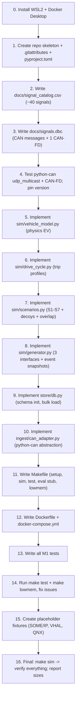

# Milestone 1 Plan — VehicleGPT (Revised)

> **Scope:** Repo skeleton, Makefile, Docker setup (2 GB / 2 CPU cap), the simulator from `simulator_spec.md`, and the labelled dataset.
> **Not in scope:** Insight engine, tools, SLM layer, UI (Milestones 2-5).
> **Decisions:** All ambiguities resolved in [docs/adr/0001-m1-decisions.md](adr/0001-m1-decisions.md).

---

## 0. Prerequisites

- [ ] Install WSL2 with Ubuntu (`wsl --install -d Ubuntu`)
- [ ] Clone / move repo to WSL filesystem (`~/vehiclegpt`)
- [ ] Install Docker Desktop with WSL2 backend
- [ ] All development happens in the WSL2 shell, not native Windows

---

## 1. Repo Skeleton

Create every directory from the planned layout, with `__init__.py` files and a brief module docstring:

```
vehiclegpt/
├── .gitattributes          # * text=auto eol=lf
├── .gitignore
├── Makefile
├── Dockerfile
├── docker-compose.yml
├── pyproject.toml           # Python 3.11+, pinned deps, type hints enforced
├── requirements.txt         # pinned, ARM-friendly only (version TBD per D4)
├── README.md
├── ingest/
│   ├── __init__.py
│   ├── base.py              # common adapter interface (ABC)
│   ├── can_adapter.py       # python-can: virtual / udp_multicast / socketcan
│   ├── someip_adapter.py    # stub — fixture-only in M1
│   ├── vhal_adapter.py      # stub — fixture-only in M1
│   ├── qnx_adapter.py       # stub — fixture-only in M1
│   ├── diag_adapter.py      # DTC/UDS ingestion
│   └── adas_adapter.py      # ADAS event ingestion
├── store/
│   ├── __init__.py
│   ├── db.py                # SQLite access, schema init from docs/schema.sql
│   ├── retention.py         # placeholder for retention/downsampling
│   └── digest.py            # trip digest + daily digest computation
├── insight/                 # empty __init__.py (M2)
├── tools/                   # empty __init__.py (M2)
├── llm/                     # empty __init__.py (M3)
├── sim/
│   ├── __init__.py
│   ├── vehicle_model.py     # physics-style EV model
│   ├── drive_cycle.py       # city/highway/mixed speed profiles
│   ├── scenarios.py         # S1-S7 scenario injectors
│   ├── generator.py         # generate_history(), run_live(), write_candump()
│   └── config.py            # seed, day count, bus config
├── eval/
│   └── ground_truth.json    # generated by `make sim`
├── ui/                      # empty __init__.py (M5)
├── docs/
│   ├── VehicleGPT_PRD.md
│   ├── problem_statement.md # renamed from "problem statement.md"
│   ├── schema.sql
│   ├── tools.schema.json
│   ├── evidence_packet.schema.json
│   ├── simulator_spec.md
│   ├── milestone_1_plan.md  # this file
│   ├── signals.dbc          # created in M1
│   ├── signal_catalog.csv   # created in M1
│   └── adr/
│       └── 0001-m1-decisions.md
├── data/
│   ├── vehicle.db           # generated by `make sim`
│   └── candump/             # selective candump logs (not full 28 days)
├── tests/
│   ├── __init__.py
│   ├── test_sim_determinism.py
│   ├── test_ground_truth.py
│   ├── test_schema.py
│   ├── test_candump_roundtrip.py
│   ├── test_can_adapter.py
│   ├── test_can_fd.py       # verifies CAN-FD on virtual bus (D5)
│   ├── test_udp_multicast.py # two-process python-can test (D4)
│   ├── test_event_snapshots.py # full-rate ±60s data around events (D2)
│   └── test_docker.py       # container builds & starts within budget
└── fixtures/                # placeholder files (D6)
    ├── someip_sample.bin
    ├── vhal_dump.json
    └── qnx_log.txt
```

---

## 2. Makefile Targets

| Target | What it does |
|---|---|
| `make setup` | Create venv, `pip install -e .` from pyproject.toml, verify deps |
| `make sim` | Run `python -m sim.generator --days 28 --seed 42 --out data/vehicle.db`; write `eval/ground_truth.json`; write selective candump files (D8); generate `docs/signals.dbc` + `docs/signal_catalog.csv`; print size report |
| `make test` | `python -m pytest tests/ -v` — unit + contract tests |
| `make eval` | Stub: prints "eval harness not yet implemented (M2)" and exits 0 |
| `make lowmem` | `docker compose up --build` with `--memory=2g --cpus=2` |

---

## 3. Docker Setup

### Dockerfile
- **Base image:** `python:3.11-slim` (multi-arch: `linux/amd64` + `linux/arm64`).
- Copy project, install deps, set entrypoint.
- No x86-only wheels. All deps must have ARM wheels or be pure-Python.

### docker-compose.yml
```yaml
services:
  vehiclegpt:
    build: .
    deploy:
      resources:
        limits:
          memory: 2g
          cpus: "2"
    volumes:
      - ./data:/app/data
```

Peak memory measured from container cgroup stats (`/sys/fs/cgroup/memory.peak` or `docker stats`), never from host.

---

## 4. Signal Catalog & DBC

### `docs/signal_catalog.csv`
~40 signals from simulator_spec.md. Columns:

```
signal,unit,source,description,aliases
vehicle_speed,km/h,can,Vehicle speed,"[""speed"",""veh_spd""]"
energy_per_km,Wh/km,derived,Energy consumption per km,"[""fuel_efficiency"",""efficiency"",""mileage""]"
range_per_charge,km,derived,Estimated range per full charge,"[""range""]"
soc,%,can,Battery state of charge,"[""battery_level"",""state_of_charge""]"
...
```

- `range_per_charge`: `source = derived`, stored only in `digest_daily` and `trips` (D1).
- Tool metric validation accepts both `signal_catalog.signal` names and `digest_daily.metric` names.

### `docs/signals.dbc`
Classic CAN (8-byte) messages, organized by group:
- `0x100` Motion (speed, accel_long, accel_lat, brake_pressure, throttle, steering)
- `0x200` Battery (soc, pack_voltage, pack_current, pack_temp, coolant_temp, coolant_pump_duty)
- `0x300` Energy (motor_power, regen_power, energy_per_km, range_estimate)
- `0x400` Climate (ambient_temp, cabin_temp, hvac_power, hvac_mode)
- `0x500` Chassis (tire_pressure_fl/fr/rl/rr, odometer)
- `0x600` ADAS (adas_state, lane_keep_active, acc_active, disengagement_reason)
- **`0x700` Diagnostics snapshot (CAN-FD, 64 bytes)** — combined ECU status; test verifies FD works on virtual bus (D5). If FD is unsupported, falls back to classic CAN.

---

## 5. Simulator (`sim/`)

### 5.1 Vehicle Model (`vehicle_model.py`)
Physics-style EV with causal signal linkage:

- **Energy:** `energy_per_km = (C_rr * m * g + 0.5 * rho * Cd * A * v^2) / eta(T) + aux_power / v`
- **HVAC:** `hvac_power = k * |cabin_target - ambient_temp|`; heating >> cooling
- **Battery thermal:** `dT_pack/dt = f(pack_current, coolant_flow, ambient)`; coolant pump duty as control
- **Range:** `usable_energy / rolling_avg(energy_per_km)`
- **SOC:** energy in/out with charging sessions

All values **quantised to DBC resolution** before writing to DB (D7). The DBC is the single source of truth for signal precision.

### 5.2 Drive Cycles (`drive_cycle.py`)
- **Daily routine:** 2 commute trips (weekday), occasional long trip (weekend), overnight charging
- **Trip types:** city (avg 30 km/h, stops), highway (avg 90 km/h, steady), mixed
- **Road type tagging:** `city` / `highway` per segment -> `city_share` / `highway_share` in trips

### 5.3 Scenario Injection (`scenarios.py`)

| ID | When | What | Overlap |
|---|---|---|---|
| **S1** | Days 7-28 | Gradual `ambient_temp` cooling (-0.5 C/day) -> HVAC load up -> `energy_per_km` up -> `range_per_charge` down 10-15% | Overlaps S2 from day 18 onward |
| **S2** | Day 18 onward | `ota_update` event; step-change `energy_per_km` +8% | Overlaps S1; interacting-causes case (D9) |
| **S3** | Day 22 | `coolant_pump_duty` ramp down over 10 min -> `pack_temp` up -> `battery_overtemp_warning` + DTC `P0A7E` | -- |
| **S4** | Days 10, 14, 21 | 3-5 `adas_disengagement` events with reason codes | -- |
| **S5** | Throughout | Natural model output: city vs highway `energy_per_km` differ ~30-40% | -- |
| **S6** | Day 10+ *(opt)* | Slow `tire_pressure_fl` leak: -0.05 bar/day | -- |
| **S7** | Day 15 *(opt)* | 2-hour signal dropout in `soc` and `pack_temp` | -- |
| **Decoys** | Various | One-off hard brake, brief warning that clears | -- |

#### S1/S2 Overlap (D9)
`ground_truth.json` for the overlap window (days 18-28) records **interacting causes**:
```json
{
  "id": "S1_S2_overlap",
  "scenario": "Range reduction -- interacting causes (temperature + OTA)",
  "ts_start": "...",
  "ts_end": "...",
  "causes": ["ambient_temp_drop + hvac_increase", "ota_update_efficiency_regression"],
  "signals": ["ambient_temp", "hvac_power", "energy_per_km", "range_per_charge"],
  "expected_facts": [
    "range_per_charge fell ~18-22% (combined)",
    "HVAC/temperature contribution ~40-50%",
    "OTA update contribution ~35-45%",
    "remainder unexplained ~10-15%"
  ]
}
```

### 5.4 Event Snapshots (D2)
For every event written to the `events` table, store **full-rate (10-50 Hz) signal data for +/-60 seconds** around the event in a dedicated table:

```sql
CREATE TABLE IF NOT EXISTS event_snapshots (
  event_id  INTEGER NOT NULL REFERENCES events(id),
  ts        INTEGER NOT NULL,
  signal    TEXT    NOT NULL,
  value     REAL    NOT NULL,
  PRIMARY KEY (event_id, ts, signal)
) WITHOUT ROWID;
```

This table is now part of the contract `schema.sql`. Rows are kept as long as their parent event (permanent until event quota). The `timeline_before` tool reads this table directly.

### 5.5 Generator (`generator.py`)
Three interfaces:
1. **`generate_history(days=28, seed=42, out_db="data/vehicle.db")`** -- bulk mode
   - Creates DB from `docs/schema.sql` + `event_snapshots` table
   - Runs vehicle model day by day
   - Writes `signals` at 1 Hz, `signals_1s`, `signals_1m`, `trips`, `digest_daily`, `events`, `dtcs`
   - Writes full-rate +/-60 s snapshots around events
   - Populates `signal_catalog` from CSV
   - Seeds `dtc_knowledge` with 30-50 hand-curated codes
2. **`run_live(bus_config, speedup=1.0)`** -- emits CAN frames on python-can bus
3. **`write_candump(path, start, duration, seed)`** -- candump-format `.log` files

### 5.6 Candump Scope (D8)
`make sim` writes three candump files only:

| File | Content | Estimated Size |
|---|---|---|
| `data/candump/day_12_full.log` | One full day (highest event density) | ~15-25 MB |
| `data/candump/s3_battery_event.log` | +/-5 min around the S3 overheating event | ~1-2 MB |
| `data/candump/test_sample_1h.log` | 1 hour of normal driving | ~2-4 MB |

`make sim` prints the actual sizes after generation.

### 5.7 DTC Knowledge Seed
Hand-written (not LLM-generated), 30-50 codes:
- `P0A7E` -- Battery pack overtemperature
- `P0A80` -- Replace Energy Storage Assembly
- `P0480` -- Cooling fan relay circuit
- `P0A1F` -- Drive motor A inverter overtemperature
- ... (relevant to scenarios S2, S3 and general EV diagnostics)

---

## 6. CAN Bus Abstraction (`ingest/can_adapter.py`)

- Single interface behind python-can
- Config-selectable: `virtual`, `udp_multicast`, `socketcan`
- Candump log replay via `can.LogReader`
- Two-process `udp_multicast` integration test (D4) determines the pinned python-can version
- CAN-FD support tested on virtual bus (D5); documented in ADR if limitations found

---

## 7. Labelled Dataset Outputs

After `make sim` completes:

| Artifact | Location |
|---|---|
| SQLite DB (28-day history) | `data/vehicle.db` |
| Candump logs (selective) | `data/candump/` (3 files, size reported) |
| Ground truth | `eval/ground_truth.json` |
| Signal catalog | `docs/signal_catalog.csv` |
| DBC file | `docs/signals.dbc` |
| Event snapshots | Inside `data/vehicle.db` (`event_snapshots` table) |

---

## 8. Tests (M1 Acceptance)

| Test | Assertion |
|---|---|
| `test_sim_determinism` | Same seed -> identical `vehicle.db` (row-for-row comparison) |
| `test_ground_truth` | Every S1-S5 event in `events`/`dtcs` with correct type and window; S1/S2 overlap recorded as interacting causes |
| `test_schema` | DB schema matches `docs/schema.sql` exactly; all tables and indices present |
| `test_candump_roundtrip` | Replay candump -> ingest -> DB rows are **exactly equal** to direct-load rows (D7: values quantised to DBC resolution at source) |
| `test_can_adapter` | Virtual bus send/receive; signal decode matches DBC |
| `test_can_fd` | CAN-FD 64-byte message on virtual bus (D5) |
| `test_udp_multicast` | Two-process send/receive via `udp_multicast` (D4) |
| `test_event_snapshots` | Full-rate +/-60 s data exists for every event (D2) |
| `test_derived_metrics` | `range_per_charge` S1 drop is within 10-15% at day 14; combined S1+S2 within 18-22% at day 28 |
| `test_storage_size` | Reports MB/day; compares with PRD ~70 MB/day estimate |
| `test_docker` | Container builds and starts within 2 GB / 2 CPU limits |

---

## 9. Dependencies (minimal, ARM-friendly)

| Package | Purpose |
|---|---|
| `python-can` | CAN bus abstraction -- version pinned after D4 test |
| `cantools` | DBC parsing, signal encode/decode |
| `numpy` | Seeded RNG, physics model math |
| `pytest` | Test runner |

All have ARM wheels or are pure-Python. No others until needed.

---

## 10. Execution Order



---

## 11. What M1 Does NOT Include

- No insight engine (M2)
- No tool implementations (M2)
- No LLM/SLM layer (M3)
- No eval harness beyond a stub (M2)
- No UI (M5)
- No voice (M5)
- No SOME/IP / VHAL / QNX real adapters (M5, stubs only)
- No fine-tuning or model download
