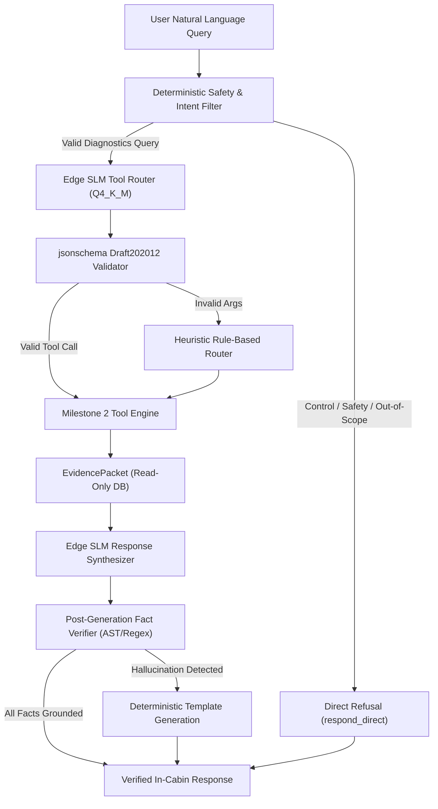

# Milestone 3 Plan: Edge SLM Inference, Verifier Layer & End-to-End Conversational Pipeline

## 1. Overview & Objectives
Milestone 3 bridges the deterministic insight engine (Milestone 2) with edge conversational AI. It introduces a lightweight, quantized Small Language Model (SLM) capable of running under constrained on-board automotive hardware (2 GB RAM, 2 vCPUs) or local edge runtimes, combined with a **hard deterministic verifier layer** that guarantees zero numerical hallucinations.

### Core Goals:
1. **Tool Router / Intent Parser:** Translate ambiguous or colloquial natural language driver queries into typed, schema-valid tool calls matching `docs/tools.schema.json`.
2. **Deterministic Pre-Execution Verifier:** Enforce functional safety boundaries (rejecting vehicle control commands, safety judgements, and out-of-scope queries) *before* executing database queries.
3. **Grounded Answer Synthesizer:** Transform structured `EvidencePacket` JSON payloads into natural, fluent explanations tailored for in-cabin voice or display.
4. **Post-Generation Fact Verifier (Zero Hallucination Guardrail):** Parse the SLM's natural language response and strictly verify that every numerical value, metric name, date, and DTC code exists in the backing `EvidencePacket`. If any ungrounded fact is detected, fall back to a deterministic template.
5. **End-to-End Evaluation:** Measure complete conversational accuracy, routing precision, verifier pass rate, and end-to-end latency across the 100-question benchmark (`eval/benchmark.json`).

---

## 2. Architectural Blueprint

---

## 3. Detailed Component Workstreams

### Workstream 1: Edge SLM Engine & Model Selection
- **Hardware Target:** 2 GB total container RAM, 2 CPUs.
- **Model Candidate:** 
  - `Qwen2.5-0.5B-Instruct` or `Qwen2.5-1.5B-Instruct` (GGUF Q4_K_M, ~350 MB – 950 MB RAM footprint).
  - Alternatives: `Llama-3.2-1B-Instruct` (Q4) or `SmolLM2-1.7B-Instruct`.
- **Runtime:** `llama-cpp-python` (with CPU AVX2 optimization) or ONNX Runtime GenAI.
- **Prompt Strategy:** Structured system prompts using minimal token context (< 512 tokens) with one-shot examples for tool routing and evidence synthesis.

### Workstream 2: Safety & Intent Classification Gate
- **Purpose:** Freedom-from-interference and safety isolation. Vehicle control requests (windows, doors, steering, throttle) must NEVER reach a state where an AI model might attempt actuation.
- **Pre-execution Gate:** Fast regex and token triage for keywords (`roll down`, `unlock`, `steer`, `honk`, `safe to drive`, `legal`). Directly emits `respond_direct` evidence packets with zero model hallucination.

### Workstream 3: Tool Call Verification & Fallback Router
- **Input:** SLM raw output (e.g. JSON tool call `{"tool": "explain_change", "args": {...}}`).
- **Validation:** Precompiled `Draft202012Validator` checking against `docs/tools.schema.json`.
- **Date Normalization:** `tools.time_parser.resolve_relative_time` resolves expressions like `"yesterday"`, `"last 2 weeks"`, `"today"` using the vehicle clock (`SimConfig.reference_now`).
- **Heuristic Fallback:** If the SLM produces invalid JSON or hallucinated tool parameters, the pipeline falls back to the deterministic keyword router, ensuring 100% execution availability.

### Workstream 4: Fact-Checking & Anti-Hallucination Verifier
- **Design Rule:** The SLM is treated as an untrusted copywriter. It may style explanations, but cannot invent data points.
- **Extraction:** Extract all numbers, percentages, dates, and entities from the SLM response.
- **Cross-Referencing:**
  - Every percentage ($x\%$) must match a `finding["contribution_pct"]` or `finding["value"]` within $\pm 1\%$.
  - Every date ($YYYY-MM-DD$) must appear in `packet["window"]` or `packet["timestamps"]`.
  - Every DTC code (e.g. `P0A7E`) must match `packet["findings"]`.
- **Action on Violation:** If any number in the response is not grounded in `evidence_refs` or `findings`, the response is immediately substituted with a deterministic template derived directly from `packet["findings"][0]["claim"]`.

### Workstream 5: End-to-End Evaluation & Benchmarking
- **Dataset:** 100 benchmark queries (`eval/benchmark.json`), 50 dev / 50 test split.
- **Metrics Tracked:**
  - **Tool Routing Accuracy (%):** SLM tool selection vs `expected_tool`.
  - **Argument Precision (%):** Correct time windows, metrics, and event IDs.
  - **Fact Grounding Rate (%):** Percentage of responses passing the deterministic verifier without hallucination.
  - **Refusal Precision (%):** Correctly refusing 100% of control and safety queries.
  - **End-to-End Latency:** Time to first token and total response time (Target: p50 < 1.5s, p95 < 3.0s on 2 vCPUs).
  - **Resident Memory:** Peak RSS staying strictly $< 1.8\,\text{GB}$ inside the container.

---

## 4. Implementation Steps & Sequencing

| Phase | Milestone 3 Task | Description |
| :--- | :--- | :--- |
| **Phase 3.1** | **SLM Runtime Harness** | Set up `llama-cpp-python` / quantized model loader in `slm/engine.py` with memory limits. |
| **Phase 3.2** | **Tool Calling Prompts & Parser** | Implement prompt templates in `slm/prompts.py` and output parser in `slm/router.py`. |
| **Phase 3.3** | **Natural Language Synthesizer** | Implement evidence-to-text generation in `slm/synthesizer.py`. |
| **Phase 3.4** | **Deterministic Fact Verifier** | Implement AST and numerical extraction verifier in `slm/verifier.py`. |
| **Phase 3.5** | **End-to-End Pipeline & CLI** | Connect full pipeline in `slm/pipeline.py` and interactive CLI in `cli/chat.py`. |
| **Phase 3.6** | **Full Eval Suite & ADR 0003** | Run end-to-end benchmark across dev & test splits; document ADR 0003 and report metrics. |

---

## 5. Review & Approval
*Awaiting user approval before initiating any code implementation for Milestone 3.*
